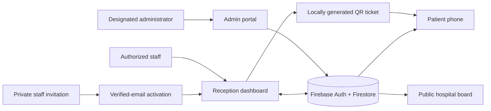

<div align="center">


<br />

### Less waiting around. More knowing what comes next.

**One calm, real-time queue experience for patients. One secure command center for hospitals.**

QR tickets · Live waiting estimates · Designated administrator · Invitation-only staff access

<br />

[](docs/SETUP-GITHUB-PAGES-FIREBASE.md)
[](https://firebase.google.com/)
[](https://pages.github.com/)
[](public/)
[](LICENSE)

<br />

[**Visit the website**](https://nittinchughani.github.io/TurnAhead/) · [**Explore v2.2**](#introducing-v22--one-hospital-one-administrator) · [**Deployment guide**](docs/SETUP-GITHUB-PAGES-FIREBASE.md) · [**Security model**](SECURITY.md)

<sub>v2.2 is staged for a rules-first deployment; the live site serves the previous release until the coordinated update is merged.</sub>

</div>

---

## A better waiting day starts with one scan

A hospital ticket shouldn't leave patients wondering how long they'll be waiting. TurnAhead gives every walk-in a **sequential ticket number with a unique QR code**. Patients scan it and see their position, estimated waiting time, and current service status—in a browser, without an app or account.

At reception, calling the next person instantly moves the shared queue forward. A public waiting-room board and the patient's own phone follow the same live Firestore updates.

<div align="center">

</div>

## Introducing v2.2 — one hospital, one administrator

**A much clearer separation between management, staff, and the public.** The person responsible for hospital access has a dedicated secure dashboard. The front desk gets a straightforward login—**no public staff registration button and no hospital creation screen**.

<table>
<tr><td valign="top" width="50%">

### 01 · Private administrator portal

- One designated **hospital owner/administrator** per hospital.
- Dedicated **Admin Login** in the main navigation.
- Live waiting, in-service and completed counts.
- Department status and estimated service durations.
- Recent anonymous patient tickets with token, department, time and status.

</td><td valign="top" width="50%">

### 02 · Administrator-approved staff

- Add a staff member's **exact work email** from the admin panel.
- Assign **Receptionist** or **Supervisor** access.
- Generate an invitation-specific activation link, valid for seven days.
- Staff activate with their **verified invited email** and set their own password.
- Change roles, revoke invitations, or disable active members.

</td></tr><tr><td valign="top">

### 03 · A simpler staff login

- Dedicated **Staff Login**; no visible create-account option.
- Only active, authorized hospital members reach reception data.
- A nonmember is shown an **access not granted** message.
- Successful sign-in opens the dashboard, not a scrolled login page.
- Friendly login and sign-out confirmations remain.

</td><td valign="top">

### 04 · Faster-feeling live experience

- Reception subscribes to queue changes **before** daily maintenance work.
- Patient ticket and waiting-room board listeners start immediately while hospital details load separately.
- Firestore streams updates to all watching devices.
- No interval-based polling, third-party QR generator, or page refresh needed for ordinary queue changes.

</td></tr>
</table>

> **A note about account creation:** Administrators approve email addresses and generate invitations; first-time staff must still activate their own Firebase account and verify their email. This avoids handing staff passwords to administrators. The login page has no public signup. Firebase Authentication can still receive account-creation requests independently, but Firestore **never grants hospital access without an approved, verified invitation or existing authorized membership**.

## Three experiences. One synchronized queue.

| Area | Path | Who can access | Purpose |
|:--|:--|:--|:--|
| **Hospital Administration** | [`admin.html`](public/admin.html) | The hospital's designated owner | Team access, departments, live analytics, anonymous ticket history, settings |
| **Staff Reception** | [`desk.html`](public/desk.html) | Approved receptionists and supervisors | Ticket issuing, calling, completing, skipping and pausing queues |
| **Staff Activation** | [`activate.html`](public/activate.html) | People with an invitation matching their verified email | Complete first-time account setup and accept hospital access |
| **Public Board** | [`board.html`](public/board.html) | Visitors with a hospital board link | Display anonymous now-serving tokens and waiting counts |
| **Patient Tracking** | [`track.html`](public/track.html) | Person holding the unique QR ticket | Live queue position and estimated wait, no signup |

### How an administrator adds staff

1. The hospital's designated administrator signs in through **Admin Login**.
2. They enter `reception@hospital.example` and select **Receptionist**.
3. TurnAhead saves a pending, time-limited invitation for that **exact email**.
4. The administrator privately shares the activation link with that employee. **No email is sent automatically.**
5. The employee sets their own password (or signs in to an existing account), verifies their email, and accepts the invitation.
6. From then on, they use **Staff Login** only. Access can be disabled from the administrator dashboard at any time.

A person who knows the hospital URL but has **no active authorized membership** cannot read the private queue controls or patient ticket collection. The front end displays an access-denied message; **Firestore Security Rules** enforce it on the backend.

### Permissions

| Capability | Hospital administrator | Supervisor | Receptionist |
|:--|:--:|:--:|:--:|
| View private admin insights and team details | ✓ | — | — |
| Add, disable, reassign staff | ✓ | — | — |
| Change hospital display name | ✓ | — | — |
| Manage department creation | ✓ | ✓ | — |
| Issue QR tickets and operate reception | — | ✓ | ✓ |
| View public queue boards and tracking | ✓ | ✓ | ✓ |

**One administrator means one owner membership** for each hospital. Older v2.1 secondary `admin` roles cannot manage staff under the v2.2 rules; the owner can downgrade them to supervisor or receptionist.

## Built on familiar, lightweight technology



- **Website:** HTML, custom CSS, and JavaScript, hosted on GitHub Pages over HTTPS.
- **Authentication:** Firebase Email/Password with email verification and per-hospital active memberships.
- **Data:** Firestore with hospital-scoped queues, tickets, invitations and access controls.
- **Live state:** Firestore snapshot listeners. Optimized to begin queue/board/ticket listeners without blocking on unrelated metadata or queue maintenance.
- **Consistency:** Firestore transactions coordinate sequential tickets and queue operations.
- **Authorization:** Firestore Rules guard every private read and write. Hiding a button is never treated as security.
- **Brand:** Original TurnAhead illustrations, matching light/dark logos, responsive typography and smooth themes.

### Patient privacy is intentional

The current release is a **queue management product**, not an electronic health record. Administrator patient detail cards contain **anonymous ticket ID/code, queue, status and arrival time**, not names, diagnoses, prescriptions, phone numbers or medical records. Ticket URLs are bearer links: a person holding the link can read that ticket's anonymous status.

Read [SECURITY.md](SECURITY.md) for security limitations and operational requirements.

## Deploy v2.2 safely

> **Do not merge the frontend before publishing its matching Firestore rules.** Version 2.1 can remain live until the rules are verified. This upgrade removes public owner and hospital self-registration, so **existing v2.1 hospital owners continue to sign in**; onboarding a *new* organization requires trusted operator provisioning.

1. Open [Firebase Firestore Rules](https://console.firebase.google.com/project/turnahead-b34f9/firestore/rules) and publish the complete new [`firestore.rules`](firestore.rules) from the v2.2 branch.
2. Confirm **Email/Password** Authentication, verified email and `nittinchughani.github.io` under authorized domains.
3. Check the existing administrator's membership still has `role: "owner"` and `active: true`. A secondary `admin` account is **not** the owner.
4. Test rules with Firebase's Security Rules emulator and, ideally, a separate test Firebase project. Check that unauthorized sign-ins, cross-hospital reads, and staff promotions fail.
5. Merge the v2.2 pull request into `main` only after those checks. GitHub Actions will publish `public/` to the existing website.
6. Sign in at **Admin Login**, add a test staff email, complete invitation activation, then verify QR tracking between desktop and phone.

**Full walkthrough:** [Firebase setup, migration and verification](docs/SETUP-GITHUB-PAGES-FIREBASE.md).

### Repository layout

```text
TurnAhead/
├── public/
│   ├── index.html          # Premium landing page + three navigation paths
│   ├── admin.html          # Owner-only administration portal
│   ├── desk.html           # Staff login and fast reception dashboard
│   ├── activate.html       # Invitation-only staff account activation
│   ├── track.html          # Patient QR ticket status
│   ├── board.html          # Hospital waiting-room board
│   ├── admin.js            # Staff management and live operational insights
│   ├── org-store.js        # Verified memberships, invitations, roles
│   ├── org-model.js        # Pure, tested authorization model
│   ├── store.js            # Firestore transactions and snapshots
│   ├── queue-engine.js     # Queue ordering and wait estimates
│   └── assets/             # Original logo, favicon and visuals
├── firestore.rules         # Backend authorization by hospital and role
├── docs/                   # Setup guide and approved illustrations
├── test/                   # Queue, organization and security checks
└── .github/workflows/      # GitHub Pages publishing and CI
```

Developers can run `npm run check` and `npm test` using Node.js 22; **hospital staff and patients need only a browser**. CI and unit tests do not substitute for live Firebase Rules tests or penetration testing.

## The road ahead

**Delivered with v2.2**

- [x] Dedicated administrator and staff sign-in navigation
- [x] One designated administrator per hospital
- [x] Administrator-controlled staff emails and invitation-only activation
- [x] Access-denied state for unregistered hospital staff
- [x] Staff role changes and account disabling
- [x] Live hospital-wide operational insights and recent anonymous ticket records
- [x] Faster startup for reception, patient tracking and public board streams
- [x] Premium README and coordinated Firebase upgrade guide

**Still to build before commercial deployment**

- [ ] Trusted platform onboarding for new hospitals and owner recovery/transfer
- [ ] Admin SDK-based account pre-provisioning / automated staff invitation email delivery
- [ ] Full Firebase Rules emulator suite, independent security audit, monitoring and operational alerts
- [ ] Data backups, deletion policy, recovery exercises and healthcare compliance evaluation
- [ ] High-volume queue scalability and latency/load testing on real networks
- [ ] Optional appointment scheduling, multi-branch organizations and consent-based notifications

**Production reality:** TurnAhead is a polished **pilot**, not a certified hospital information system. There is no medical record storage, identity verification of organizations, guarantee of low latency, or formal compliance certification. Real deployments require security testing, privacy review, staff training, backup planning and a support process.

---

## Open source. Built to make waiting easier.

Thoughtful contributions are welcome. Read [CONTRIBUTING.md](CONTRIBUTING.md), follow [SECURITY.md](SECURITY.md), and keep real patient information out of examples. Licensed under [MIT](LICENSE); the QR encoder's attribution remains at [`lib/qr/LICENSE`](lib/qr/LICENSE).

<div align="center">

**TURNAHEAD**

*Know when it's your turn.*

Made by [Nittin Chughani](https://github.com/NittinChughani) · Designed for the moments that matter.

[Back to top ↑](#a-better-waiting-day-starts-with-one-scan)

</div>
