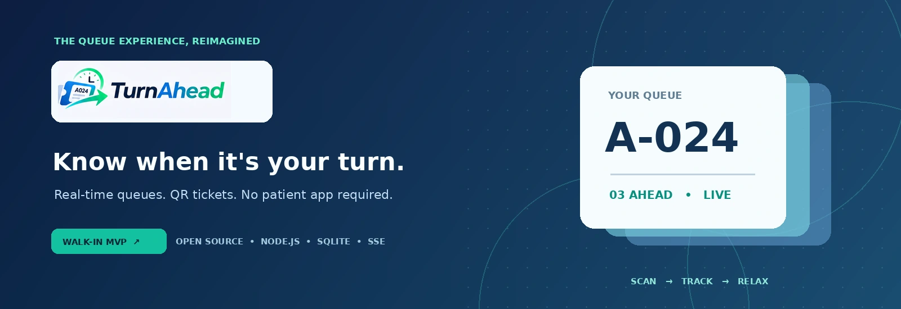
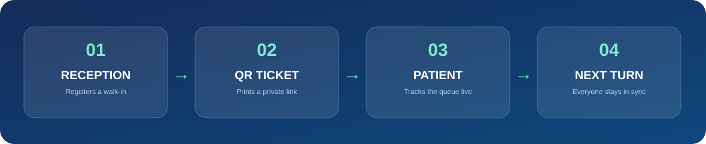
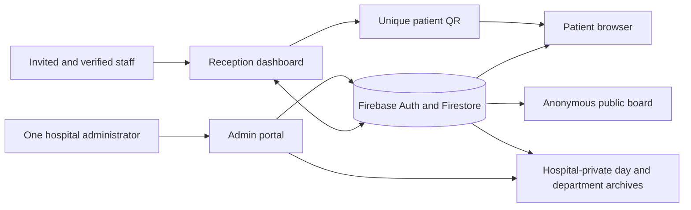

<div align="center">



<br />

### Know when it's your turn. Make every turn count.

**The modern queue experience for hospitals and clinics.**  
*Real-time patient tracking. Reception that stays in sync. One clear administrator command center.*

<br />

[](docs/SETUP-GITHUB-PAGES-FIREBASE.md)
[](https://firebase.google.com/)
[](https://pages.github.com/)
[](public/)
[](LICENSE)

<br />

[**Visit TurnAhead ↗**](https://nittinchughani.github.io/TurnAhead/) · [**What's new**](#introducing-turnahead-v23) · [**How it works**](#three-perspectives-one-live-queue) · [**Deployment**](docs/SETUP-GITHUB-PAGES-FIREBASE.md) · [**Security**](SECURITY.md)

<sub>v2.3 is prepared for a coordinated Firestore-rules upgrade. The live website stays on v2.2 until the release is merged.</sub>

</div>

---

## An easier wait for everyone

A paper ticket should not leave a patient guessing. TurnAhead creates a department-specific QR ticket at reception. The patient scans it and immediately sees **their name, current ticket status, number of people ahead, and an approximate clock time** for their turn—without installing an app or creating an account.

Reception uses a live dashboard to call, complete, or skip a patient. An administrator oversees staff, departments, and **private, dated attendance records**. The public waiting-room board shows current queue numbers and a clock; it **never publishes patient names**.

<div align="center">

</div>

## Introducing TurnAhead v2.3

<table>
<tr><td width="50%" valign="top">

### 01 · Accurate real-time status

- Patient status comes from the **individual ticket record**.
- **Called** means the ticket is being served; **Completed** means the visit was marked attended; **Skipped** means missed.
- When separate Firestore snapshots arrive briefly out of order, the screen shows **Updating…** instead of falsely showing **YOUR TURN**.
- A completed or skipped ticket remains final even if the department starts another ticket.

</td><td width="50%" valign="top">

### 02 · Named QR tickets

- Reception enters a **patient's name** before generating their QR code.
- The print-ready receipt and the patient's private QR page both show their name.
- The QR page includes **approximate arrival time** (for example, *around 5:30 PM*), along with the estimated wait range.
- Ticket links should be treated as confidential: **anyone holding the QR URL can see that ticket's name and status**.

</td></tr><tr><td valign="top">

### 03 · Department numbering

- The first three letters of the department form the visible ticket prefix.
- **Cardiology → CAR-000, CAR-001, … CAR-999, CAR-1000**, with no rollover at 999.
- Each department has its own daily sequence.
- At **12:00 AM Pakistan Standard Time**, the next ticket starts again at **000**. Existing active queues are reset on first activity after midnight.
- Department names that would collide on the same prefix are rejected.

</td><td valign="top">

### 04 · Private date-wise history

- Patient records are stored **as soon as tickets are issued** and updated transactionally when reception calls, completes, or skips them—**not dependent on a midnight browser timer**.
- The administrator gets a **date-by-date, department-specific** archive and ticket-code search.
- Records include name, ticket number, issued time, called time, finished time and attendance (**Attended / Missed / Pending**).
- Archives are administrator-only and are paginated for larger dates.

</td></tr><tr><td valign="top">

### 05 · More personal staff access

- Hospital owners invite staff with **name, approved email, gender/title, and role**.
- The reception dashboard greets staff as **Mr Name** or **Ms Name**, according to the selected value.
- **Update details** lets the administrator correct staff names, titles, and roles, or send a secure Firebase password-reset email.
- Existing invitation-only registration, verified email, and revocation controls remain.

</td><td valign="top">

### 06 · Faster, clearer sign-in

- An animated **Signing in / Checking access** spinner appears immediately after submission.
- The reception or admin panel appears as soon as authorization completes, with no artificial multi-second delay or scrolling.
- Firebase response time varies with connectivity and cannot be guaranteed at exactly three seconds.
- The public board shows a live **HH:MM:SS** Pakistan Standard Time clock.

</td></tr>
</table>

## Three perspectives. One live queue.

| Experience | Page | What it does |
|:--|:--|:--|
| **Hospital administrator** | [`admin.html`](public/admin.html) | One designated owner, staff invitations and profile changes, departments, live metrics, private dated patient history |
| **Reception staff** | [`desk.html`](public/desk.html) | Approved staff sign in, issue named tickets, call next, complete, skip, pause and resume |
| **Staff activation** | [`activate.html`](public/activate.html) | Verified-email, invitation-only onboarding; staff set their own passwords |
| **Patient QR status** | [`track.html`](public/track.html) | Name, ticket code, status, queue progress and approximate clock time |
| **Public waiting-room board** | [`board.html`](public/board.html) | Anonymous now-serving codes, waiting counts and current time |

### Example: one department, one day

```text
Cardiology                               13 November 2026 · PKT
──────────────────────────────────────────────────────────────
CAR-000    Ayesha Khan     Issued 09:10   Called 09:17   Attended
CAR-001    Hamza Ali       Issued 09:14   Called 09:26   Missed
CAR-002    Sara Malik      Issued 09:20   Waiting       Pending
...
CAR-999    …
CAR-1000   …
──────────────────────────────────────────────────────────────
Next day: CAR-000 again (separate dated records)
```

<sub>Illustrative fictional sample—never put actual patient names in GitHub documentation or screenshots.</sub>

### Administrator-controlled staff accounts

An administrator invites an **exact email address**, enters the employee's name and selects **Male / Female** for the displayed honorific. The employee receives a **manually shared activation link**, signs up (or signs in) through that dedicated page, verifies their email and joins the hospital. The staff login itself never offers public registration.

For existing members, **Update details** changes the display name, title or role. A forgotten password is handled by a Firebase password-reset email, **not by revealing or setting passwords in the admin interface**. Changing a staff email means revoking the old membership and inviting the corrected address; Firebase Auth email is not silently modified.

### Permissions

| Capability | Designated owner | Supervisor | Receptionist | Public/QR holder |
|:--|:--:|:--:|:--:|:--:|
| Manage invitations and staff profiles | ✓ | — | — | — |
| View private attendance history | ✓ | — | — | — |
| Create departments | ✓ | ✓ | — | — |
| Run reception queues and issue tickets | — | ✓ | ✓ | — |
| View anonymous board | ✓ | ✓ | ✓ | ✓ |
| View a named ticket by **its QR link** | ✓ | ✓ | ✓ | ✓ |

## Architecture



- **Static frontend:** HTML, custom CSS and vanilla JavaScript on GitHub Pages.
- **Identity:** Firebase Email/Password Auth and verified, hospital-scoped memberships.
- **Queue consistency:** Firestore transactions update queue, ticket and dated archive together.
- **Live delivery:** Snapshot listeners (not manual refreshes) on individual ticket and queue documents.
- **Isolation:** Firestore Security Rules enforce hospital ownership, authorization, and owner-only history access.
- **QR generation:** Runs locally in the browser, with no external QR processing service.
- **Design:** Original TurnAhead branding, light/dark themes, responsive layouts, polished admin and reception experiences.

### Privacy matters more now

Version 2.3 deliberately adds **patient names** to tickets, and stores names in administrator-only dated archives. **QR URLs are bearer links:** people who receive or photograph the link can see the name and status tied to that ticket. The public board shows **codes only**, not names. No clinical diagnoses, national IDs, prescription details, or medical records belong in TurnAhead.

Archives are retained in Firestore until an authorized retention/deletion process is implemented; **automatic data purging is not included**. Hospitals must establish lawful notice/consent, retention periods, authorized access, backups, and compliance before using real patient information. Read [SECURITY.md](SECURITY.md).

## Deploy v2.3 without disrupting the live site

**Publish and test the matching [`firestore.rules`](firestore.rules) *before* merging the v2.3 code.** The current live v2.2 site remains accessible until the upgrade is deliberately merged. Rules preserve v2.2 document shapes during a coordinated transition.

1. Finish active queues and confirm the current designated owner can sign in.
2. Publish the **v2.3 branch** Firestore rules in the existing [TurnAhead Firebase project](https://console.firebase.google.com/project/turnahead-b34f9/firestore/rules) **after testing in a Firebase emulator or separate test project**.
3. Verify a new named ticket can be created, an unregistered user is denied, a supervisor cannot read patient history, and a hospital owner can search a dated archive.
4. Merge the v2.3 pull request to `main` to deploy GitHub Pages. Test with a reception computer and a real QR-scanning phone.

**Important migration note:** Existing v2.2 tickets remain in Firestore but are **not retroactively added** to the new private dated archive. Existing active department prefixes switch to the three-letter format **at the next daily reset**; an untouched older queue can switch immediately. Do not mix ticket generations during active clinical operations.

See the [complete upgrade guide](docs/SETUP-GITHUB-PAGES-FIREBASE.md).

## Repository structure

```text
TurnAhead/
├── public/
│   ├── index.html             # Welcome and entry points
│   ├── admin.html / admin.js  # Owner dashboard, staff editing and date-wise history
│   ├── desk.html / desk.js    # Staff reception, named QR issuing and queue operations
│   ├── activate.html          # Invitation-specific staff activation
│   ├── track.html / track.js  # Live named ticket status with approximate turn clock
│   ├── board.html / board.js  # Anonymous public board + HH:MM:SS clock
│   ├── store.js               # Atomic Firestore queue, ticket and archive updates
│   ├── queue-engine.js        # Numbering, dates, synchronization and ETA calculations
│   ├── org-store.js           # Staff profiles, invites, membership and password resets
│   └── assets/                # Original TurnAhead marks, graphics and favicon
├── firestore.rules            # Backend roles and archive read restrictions
├── docs/                      # Setup and migration guide
├── test/                      # Automated functional and structural regressions
└── .github/workflows/         # CI and GitHub Pages deploy
```

Developers can run `npm run check` and `npm test` using Node.js 22. **Hospital staff and patients require only a browser.** Automated logic checks are not a replacement for Firebase emulator security tests or a real two-device end-to-end test.

## Roadmap

**Delivered in v2.3**

- [x] Patient status synchronization with authoritative completed/missed state
- [x] Named patient QR receipts and named tracking pages
- [x] Three-letter department codes, `000` start, `999` → `1000` and midnight reset
- [x] Department-specific, date-wise private archives and exact ticket search
- [x] Invited staff names, Male/Female honorifics and admin profile editing
- [x] Secure staff password-reset email workflow
- [x] Authentication progress animation and public board live clock
- [x] Approximate turn time displayed on patient tracking

**Before a hospital production rollout**

- [ ] Firebase Security Rules emulator testing and independent penetration testing
- [ ] Real-device latency benchmarks; no fixed maximum sign-in/update latency can be promised
- [ ] Consent, retention and deletion workflows for personally identifiable patient data
- [ ] Hospital provisioning, backup/recovery, incident response and operational monitoring
- [ ] High-volume queue load tests and attendance auditing

**TurnAhead is a polished pilot, not a certified medical records or appointment system.** Completion/missed status reflects reception actions, not independent proof of attendance.

---

<div align="center">

**TURNAHEAD**

*Know when it's your turn.*

Built with care by [Nittin Chughani](https://github.com/NittinChughani) · Licensed under [MIT](LICENSE)

[Back to top ↑](#know-when-its-your-turn-make-every-turn-count)

</div>
