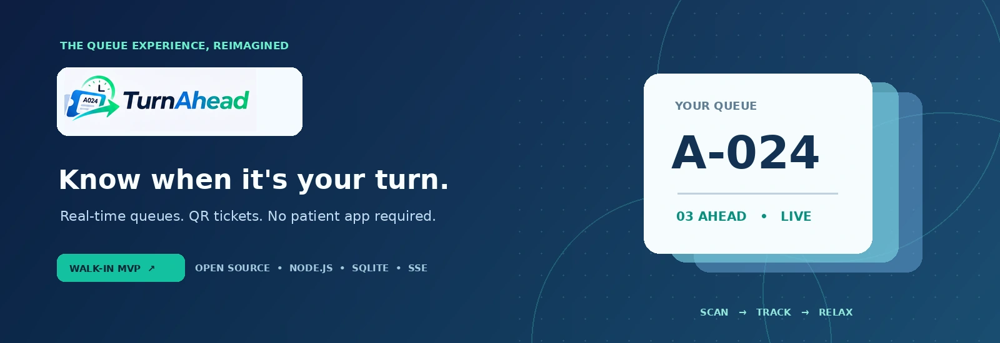
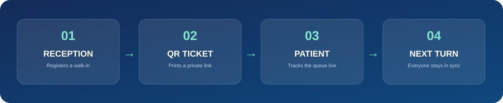
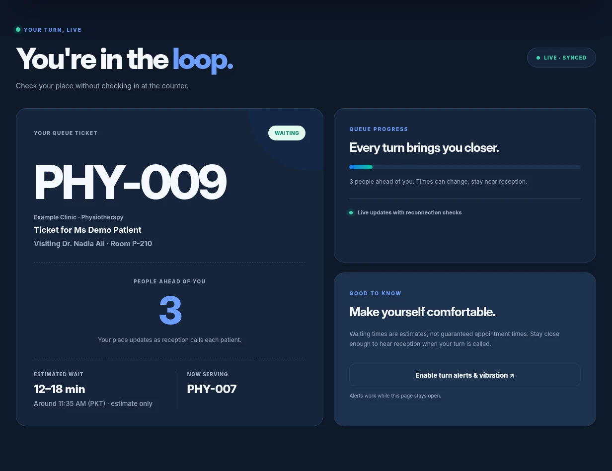
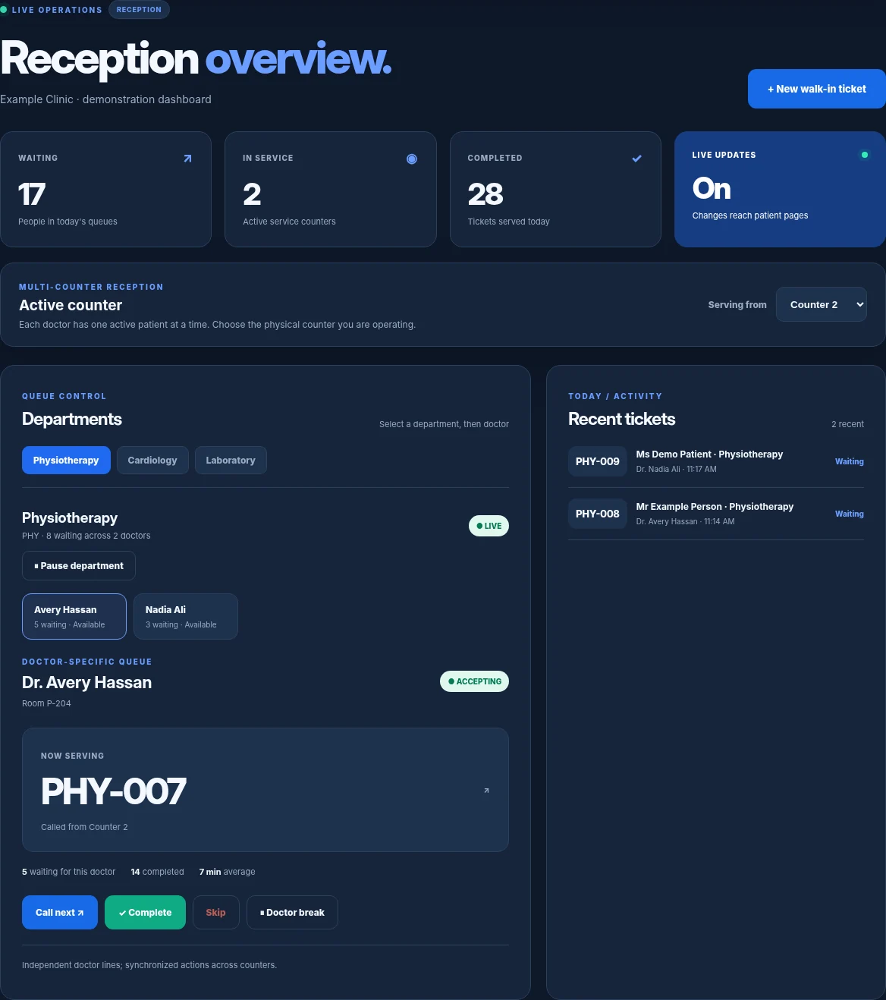
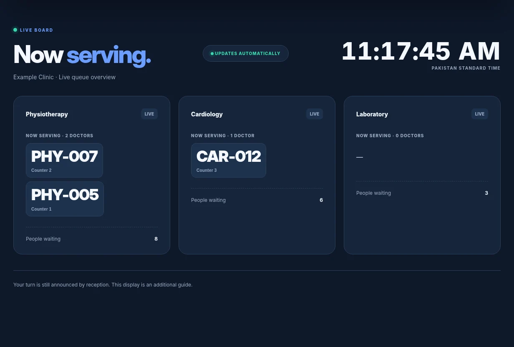
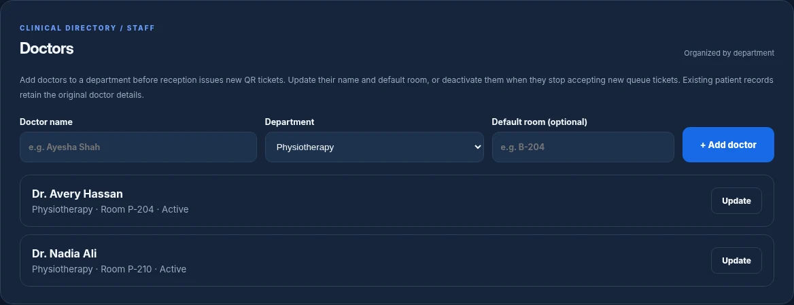
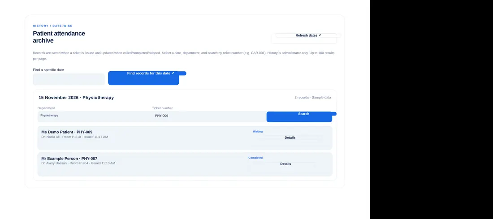
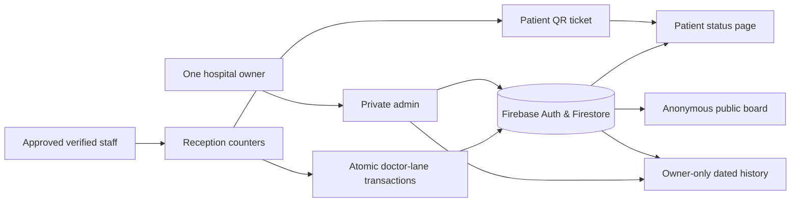

<div align="center">



# TurnAhead

### Your turn. Without the wait.

**A smarter walk-in queue for hospitals and clinics.** A printed QR ticket, a clear place in line, and live updates from reception. No patient account or app installation.

[](docs/SETUP-GITHUB-PAGES-FIREBASE.md)
[](test/)
[](https://firebase.google.com/)
[](https://pages.github.com/)
[](LICENSE)

[**View website ↗**](https://nittinchughani.github.io/TurnAhead/) · [**How it works**](#01--the-walk-in-experience) · [**What's new in v2.5**](#02--reception-built-for-real-teams) · [**Deploy safely**](docs/SETUP-GITHUB-PAGES-FIREBASE.md) · [**Security**](SECURITY.md)

<sub>**Release note:** v2.5 code is prepared on a review branch. The public website remains at v2.4 until the matching Firebase rules are tested/published and this release is merged.</sub>

</div>

---

## An easier wait for everyone

Patients should be able to spend their waiting time somewhere comfortable without constantly looking at the display. Reception issues a **department-coded QR ticket**; patients scan to follow their turn. An administrator manages the authorized team, departments, doctors and private dated records. **TurnAhead is for walk-in queues, not online appointment booking.**

<div align="center">

</div>

### See the experience, not just the feature list

> **About the images:** The previews below are rendered from TurnAhead's actual HTML and CSS using **fictional demonstration tickets and hospital names**. They are interface illustrations, **not live patient data or proof of a successful Firebase deployment**. Browser rendering may differ slightly.

## 01 · The walk-in experience

<div align="center"></div>

1. **Receive a QR ticket.** Reception enters the patient's name/title, department, selected doctor and room. Ticket numbers look like `PHY-001`, `PHY-002` and reset at midnight Pakistan time.
2. **Scan and follow.** The private page displays patient/doctor/room details, doctor-specific queue position, approximate turn time and a connection-status indicator.
3. **Get called.** An individual ticket's `calledAt` and counter are preserved. The patient sees **YOUR TURN** when the live event arrives—or, after Safari wakes from suspension, the recorded call time and final outcome. **No background-delivery guarantee.**

**New in v2.5:** the ticket record is the source of truth; the QR page listens for Firestore cache/server metadata, refreshes from the server when reopened and periodically while visible, and reports offline/reconnecting status. This reduces stale statuses without claiming that iOS can always display every intermediate event instantly.

## 02 · Reception built for real teams

<div align="center"></div>

1. **Choose the physical counter** (`Counter 1`–`Counter 12`) and the service department.
2. **Select a doctor.** Each doctor has their **own first-in, first-out line**, while the department retains one daily ticket numbering sequence.
3. **Call, complete, skip or pause.** Actions use a single Firestore transaction to update the doctor lane, private control record, individual ticket and dated attendance archive. Two counters cannot both claim the same waiting ticket. A counter cannot call another patient within the same department until its current ticket finishes.

Doctor breaks pause **new issuance and calls for that doctor**, not other doctors. Staff may still complete an active ticket during the break. A department-wide pause/resume control remains available. Finishing a ticket requires selecting the **counter that called it**, which also permits staff handover at that counter.

**Deployment note:** v2.5 introduces doctor lanes inside department queue/control documents. **Finish all v2.4 queues before migration**, ideally outside reception hours. Existing tickets and records are not deleted or renumbered.

## 03 · The public waiting-room board

<div align="center"></div>

1. Display the board on a waiting-room screen using the hospital-specific URL.
2. Visitors see anonymous **now-serving ticket codes**, assigned counters, waiting totals and the large **12-hour clock** with AM/PM and seconds.
3. Doctor lanes can serve in parallel; the board never exposes patient names or medical details.

The board complements human announcements. It should not be treated as the sole way to notify someone of their turn.

## 04 · Doctor directory & department setup

<div align="center"></div>

1. The designated hospital owner registers doctors in their departments, with optional default rooms.
2. Reception can select **active doctors from the chosen department** when issuing a ticket.
3. An owner may update doctor names/rooms or deactivate/reactivate entries. **Department assignments stay fixed** once a doctor is registered, protecting active queues and historical records; moving a doctor requires a new entry in the new department.

## 05 · Private records and accountability

<div align="center"></div>

1. The designated administrator chooses a **date** and **department**, then optionally searches by a ticket code.
2. Click **Details** to see the ticket's name/title, doctor, room, timestamps and attendance outcome.
3. Reception call/completion actions update the archive atomically; new private fields record which **authorized staff UID** called or finished the ticket, without exposing those staff UIDs on the public QR link.

Staff can create/update archived records as part of ticket transactions but **cannot browse the private archive**. Statuses are reception-entered operational events, not proof of actual medical attendance.

## 06 · A quieter, more polished interface

- **Glassmorphism navigation:** translucent, blurred and lightly reflective header with dark-theme contrast, a solid-color fallback, and reduced-transparency support.
- **Immediate loading feedback:** no artificial authentication delay, and a visible animated queue loader while connecting.
- **One staff login:** the homepage navigation avoids duplicate Staff Login entries.
- **English UI, light/dark themes, mobile layouts:** patient tracking works without login or app installation.
- **Vibration where supported:** optional in-page vibration on compatible devices. **WebKit/iPhone Safari does not provide reliable Web Vibration API support**; iOS background push alerts are not included.

## Product perspectives

| Person | Page | Allowed to do |
|:--|:--|:--|
| **Hospital owner** | [`admin.html`](public/admin.html) | Authorize staff; manage doctors and departments; view private date-wise patient history |
| **Approved staff** | [`desk.html`](public/desk.html) | Issue named tickets, select counters, serve doctor lanes, pause/resume and complete/skip |
| **Patient** | [`track.html`](public/track.html) | Open their **private bearer QR link** to view name, doctor, room, live status and call time |
| **Waiting-room visitors** | [`board.html`](public/board.html) | View anonymous tokens, counters, waiting numbers and clock |

## Architecture & access boundaries



**Technology:** static HTML/CSS/vanilla JavaScript hosted on GitHub Pages, Firebase Authentication, Cloud Firestore and local SVG QR generation. Patient pages read their ticket via an unpredictable ID in the private URL; **sharing the link shares the patient name, doctor, room and status**. Do not enter diagnoses, prescriptions, ID numbers or other clinical data.

**Performance and security limitations:** browser suspensions, networking and Firebase outages can delay alerts. Visible-page rechecks consume Firestore reads; high-volume concurrency needs load testing. Firestore rules are not yet emulator-validated, backup/retention tooling is not implemented, and a legal/privacy assessment is essential before processing real patient information.

## Deploy v2.5 carefully

**The code upgrade and its [`firestore.rules`](firestore.rules) must be coordinated.** The GitHub Pages site should remain on v2.4 until after the rules are verified.

1. **Before migration:** finish current v2.4 patients, verify the designated owner, and back up Firestore. Existing active v2.4 lanes **do not migrate automatically** to the new doctor-specific flow.
2. **Test** in the Firebase Emulator or a separate Firebase project: active/disabled staff, doctor membership, doctor immutability, atomic ticket/queue/archive updates, cross-hospital access and denied history reads.
3. **Publish** the exact branch `firestore.rules` to the [TurnAhead Firebase project](https://console.firebase.google.com/project/turnahead-b34f9/firestore/rules) after verification. Test the existing v2.4 site still works.
4. **Merge** the review PR to `main` only after the rules are active. Wait for GitHub Pages to deploy, then test two counters, two doctors and two different devices using **fictional** patient records.
5. **Acceptance:** on Android and iPhone, test waiting → called → completed, waiting → called → skipped, device locking/unlocking, offline/reconnect, doctor break, midnight reset and concurrent Call next.

More detail: [Firebase setup and v2.5 migration](docs/SETUP-GITHUB-PAGES-FIREBASE.md) · [Security/privacy notes](SECURITY.md).

## Run the project

```bash
npm run check
npm test
```

Node.js 22 is used only by developers running tests. Hospitals and patients use the hosted website. **57 unit/structural checks passing is not the same as real Firestore Rules Emulator testing or Safari end-to-end validation.**

## Roadmap

- [x] **v2.4:** doctor directory, named QR tickets, dated patient history, admin/staff roles.
- [x] **v2.5 implementation candidate:** doctor-specific queues, 12 reception counters, doctor pauses, real-time resync recovery, transaction regression tests and glass navigation.
- [ ] **v2.5 deployment gate:** real Firebase Rules Emulator, iOS/Android two-device verification, load and recovery tests.
- [ ] **v2.6:** near-turn alerts, missed-turn grace, "I'm here" confirmation, English/Urdu, voice announcements and optional patient feedback.
- [ ] **v3.0:** advanced analytics, exportable reports, hospital branding and validated market launch.

**TurnAhead is a queue-management pilot, not a medical record system or appointment-booking product.** Production use requires access/privacy audits, monitoring, backups, retention procedures, a real pilot, and independent security review.

---

<div align="center">

**TURNAHEAD** · *Your turn. Without the wait.*

Built by [Nittin Chughani](https://github.com/NittinChughani) · [MIT License](LICENSE)

</div>
