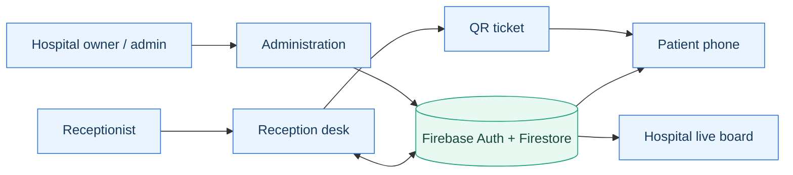

<div align="center">


<br />

### Less waiting around. More knowing what comes next.

**A beautifully simple, real-time queue experience for hospitals, clinics, and the people they serve.**

Give reception a better way to manage the day. Give visitors the confidence to step away from the counter.

<br />

[](docs/SETUP-GITHUB-PAGES-FIREBASE.md)
[](public/)
[](https://firebase.google.com/)
[](https://pages.github.com/)
[](LICENSE)

<br />

[**Open website**](https://nittinchughani.github.io/TurnAhead/) · [**Explore features**](#designed-for-everyone-in-the-waiting-room) · [**Hospital setup**](docs/SETUP-GITHUB-PAGES-FIREBASE.md) · [**Security**](SECURITY.md)

<sub>**Deployment note:** The live website remains on v2.0 until the new Firebase rules are published and this release is merged into `main`.</sub>

</div>

---

## The problem we're solving

The waiting room doesn't have to feel like a guessing game.

A visitor receives a ticket. The number doesn't tell them how many people are ahead, whether the counter is paused, or when their turn might come. Reception gets interrupted with the same question. Again and again.

**TurnAhead replaces uncertainty with one simple scan.**

Reception creates a queue ticket with a unique QR code. The patient opens it in any browser and watches their place update live. When a receptionist calls the next number, the patient sees it on their own phone. No patient signup. No app to install. No repeated trip to the desk.

<div align="center">
  
</div>

## Introducing v2.1 — hospital & staff management

**From one reception desk to an entire organization.**

This release keeps everything people liked about the original TurnAhead experience while adding the foundation hospitals need to use it with their own teams.

<table>
<tr>
<td valign="top" width="50%">

### 01 · Organization workspaces

- Create a hospital or clinic workspace from the website.
- Keep each hospital's queues, staff, invitations and internal operations separate.
- Switch between hospitals you have permission to access.
- Set your hospital's display name and public board link.

</td>
<td valign="top" width="50%">

### 02 · Staff invitations & roles

- Owner- and admin-managed staff invitations.
- Verified-email invitation acceptance and 7-day expiry.
- Receptionist, supervisor, administrator and owner roles.
- Change roles or disable staff access without editing Firebase UIDs by hand.

</td>
</tr>
<tr>
<td valign="top" width="50%">

### 03 · A more polished login

- Clear **login successful** and **signed out** confirmations.
- Open the dashboard immediately after sign-in—no scrolling to find it.
- Dedicated staff registration and email verification.
- Authenticated sessions and helpful permission messages.

</td>
<td valign="top" width="50%">

### 04 · Reception stays simple

- One-tap **Call next**, **Complete**, **Skip**, **Pause** and **Resume**.
- Independent departmental queues and sequential numbers.
- Printable QR tickets, live waiting room boards and real-time patient updates.
- Original premium UI, smooth interactions and light/dark themes.

</td>
</tr>
</table>

> **Designed around a principle:** Powerful for administrators. Effortless for receptionists. Reassuring for patients.

---

## Designed for everyone in the waiting room

| Experience | Who it's for | What they can do |
|:--|:--|:--|
| **Home** · `index.html` | Everyone | Understand TurnAhead and find staff access |
| **Reception** · `desk.html` | Authorized staff | Issue tickets, move queues and watch daily activity |
| **Administration** · `admin.html` | Hospital owner and admins | Invite staff, change roles, manage departments and hospital settings |
| **My Turn** · `track.html?hospital=...&ticket=...` | Ticket holder | View live number ahead, estimated wait and service status |
| **Live board** · `board.html?hospital=...` | Waiting-room visitors | View the hospital's anonymous now-serving numbers |

### A real hospital workflow

1. **Create:** A hospital owner creates a workspace and adds service departments.
2. **Invite:** The owner or an administrator creates role-based staff invitations, copies the link and shares it with the right people.
3. **Join:** Staff verify their invited email, accept access and sign in to the reception dashboard.
4. **Issue:** Reception prints a ticket with a unique QR code and sequential queue number.
5. **Track:** The patient scans once and sees real-time queue progress on their phone.
6. **Move:** Reception calls the next person. The patient's screen and that hospital's public board update automatically.

**Important:** Version 2.1 generates invitation links for administrators to share; it does **not** automatically email staff members. Patients never require accounts.

## Roles that make sense

| Capability | Owner | Administrator | Supervisor | Receptionist |
|:--|:--:|:--:|:--:|:--:|
| Sign in and run reception queues | ✓ | ✓ | ✓ | ✓ |
| Issue and print QR tickets | ✓ | ✓ | ✓ | ✓ |
| Create service departments | ✓ | ✓ | ✓ | — |
| Invite and manage reception/supervisor staff | ✓ | ✓ | — | — |
| Invite and manage other administrators | ✓ | — | — | — |
| Update hospital display name | ✓ | ✓ | — | — |
| Create or transfer the owner role | — | — | — | — |

Role restrictions are enforced in **Firestore Security Rules**, not only by disabled buttons in the interface. Every hospital has its own membership and collection paths. An email/password login alone does not grant hospital staff access.

---

## Architecture: a website, not an installation

TurnAhead runs on **GitHub Pages + Firebase**. No persistent Node server, local database, Render account or desktop app is required for anyone using the website.



| Layer | Technology | Why it matters |
|:--|:--|:--|
| Frontend | HTML, custom CSS, vanilla JavaScript | Responsive, polished and lightweight |
| Static hosting | GitHub Pages + GitHub Actions | One HTTPS website, automatically deployed from `main` |
| Authentication | Firebase Email/Password + verified email | Individual staff identity and secure invitation claims |
| Shared data | Cloud Firestore + live snapshot listeners | Two or more devices see the same queue state |
| Consistency | Firestore transactions and atomic membership claims | Unique ticket numbers and safer concurrent updates |
| Authorization | Hospital-scoped Firestore Security Rules | Cross-hospital isolation and role restrictions |
| QR tickets | Bundled, locally generated QR encoder | No third-party QR API required |
| Quality checks | Node.js built-in tests + GitHub Actions CI | Testable queue and permission logic; Node is **development-only** |

### Privacy by design

- Tickets contain anonymous token codes, queue status and times—**not patient names or medical details**.
- A public board can only show anonymous queue status for a known hospital workspace ID.
- Secret ticket IDs remain out of public collection listings. Ticket URLs work as possession-based links and should not be published openly.
- Staff access is tied to a hospital membership, verified email and active role. Admin actions do not give staff permission in unrelated hospitals.
- Ownership is not transferable from the browser, and administrators cannot assign themselves the owner role.

Read the full [security model and limitations](SECURITY.md).

---

## Get TurnAhead running

**Already running v2.0? Use the safe release procedure below.** The new frontend requires the new Firestore rules; the two changes should not be separated casually.

<div align="center">

### [Read the v2.1 release & Firebase setup guide →](docs/SETUP-GITHUB-PAGES-FIREBASE.md)

</div>

1. **Publish the new Firestore rules** from [`firestore.rules`](firestore.rules) in Firebase Console. The rules temporarily preserve existing v2.0 writes through **11 December 2026**.
2. **Merge v2.1 to `main`.** The included GitHub Pages workflow deploys the `public/` directory to the existing live URL.
3. **Verify your email** and sign in. A hospital owner creates their workspace and becomes its initial owner.
4. **Invite staff and add departments** in `admin.html`. Copy each invite link to the intended email owner; email verification is mandatory.
5. **Test on separate devices** by issuing a new QR ticket and calling the next visitor. Share the correct hospital-specific live board link.

> **Migration warning:** Existing v2.0 queue documents remain in Firestore but do **not** automatically become the new hospital's live queues. Finish outstanding older tickets before cutover. The old QR page will explain that the ticket is historical. Please don't switch during active patient service without a planned transition.

### Project layout

```text
TurnAhead/
├── public/
│   ├── index.html         # Product website
│   ├── desk.html          # Staff sign-in, onboarding and reception
│   ├── admin.html         # Hospital owner/admin console
│   ├── track.html         # QR-linked patient progress
│   ├── board.html         # Hospital-specific live display
│   ├── org-store.js       # Memberships, invites and role actions
│   ├── org-model.js       # Testable organization permissions
│   ├── store.js           # Hospital-scoped Firestore queues
│   ├── queue-engine.js    # Ticket ordering and estimates
│   ├── firebase.js        # Browser Firebase initialization
│   ├── styles.css         # Responsive premium brand system
│   └── assets/            # Original light/dark logo & favicon
├── firestore.rules        # Hospital isolation & role enforcement
├── docs/                  # Illustrated workflow & setup guide
├── test/                  # Queue and organization unit tests
└── .github/workflows/     # CI & Pages deployment
```

### Developer commands (optional)

```bash
npm run check
npm test
```

Hospital users **never** need to run these commands. All functionality is accessed from the normal HTTPS website.

---

## What's next

**Delivered in v2.1**

- [x] Independent hospital/clinic workspaces
- [x] Owner onboarding and verified staff accounts
- [x] Seven-day staff invitations with accept/revoke flow
- [x] Admin, supervisor, receptionist and owner roles
- [x] Admin dashboard for members, settings and departments
- [x] Hospital-specific queue data and QR tracking links
- [x] Login/logout confirmations and direct dashboard navigation
- [x] Original premium branding, responsive design and themes

**Still on the roadmap**

- [ ] End-to-end Firebase emulator security tests and third-party audit
- [ ] Staff audit trail, automatic retention and backup strategy
- [ ] Organization approval/licensing and billing
- [ ] Automatic invitation email delivery
- [ ] Large-queue scaling and multi-branch administration
- [ ] Appointments and hybrid scheduled/walk-in queues
- [ ] Optional patient notifications with proper consent

**Production reality:** This release is a **multi-hospital pilot**, not a certified hospital management platform. It has no audited regulatory compliance, billing, guaranteed uptime, disaster recovery plan or clinic credential verification. Firebase costs/quotas and rules apply. Professional testing is necessary before any hospital relies on it in daily operations.

---

## Open source. Built to be useful.

Thoughtful contributions are welcome. Read [CONTRIBUTING.md](CONTRIBUTING.md), respect [SECURITY.md](SECURITY.md) and keep patient data out of examples. The project is published under the [MIT License](LICENSE); bundled QR encoder attribution is retained in [`lib/qr/LICENSE`](lib/qr/LICENSE).

<div align="center">

<br />

**TURNAHEAD**

*Less uncertainty. A better waiting day.*

Made by [Nittin Chughani](https://github.com/NittinChughani) · Designed for real people, one queue at a time.

[Back to top ↑](#the-problem-were-solving)

</div>
